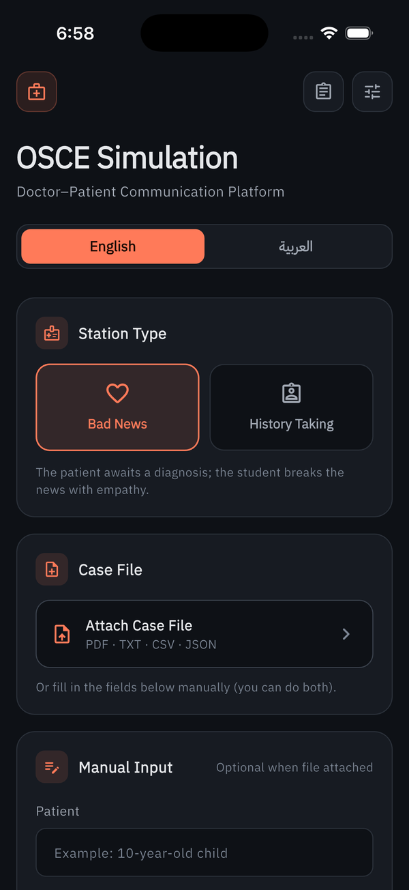
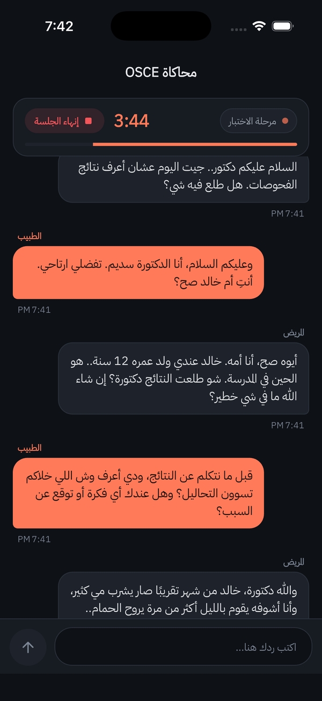
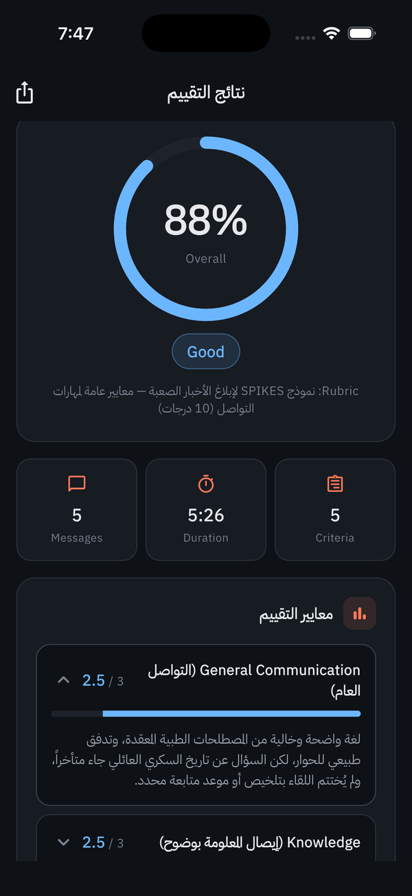
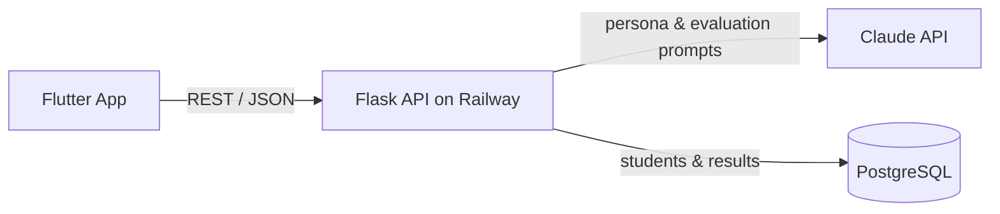

# OSCE Simulator — AI-Powered Clinical Communication Trainer

A cross-platform Flutter app that lets medical students practice **OSCE communication stations** with an AI-simulated patient, then get **graded automatically against their own university's rubric**.

> 🎓 Graduation project · Flutter + Flask + PostgreSQL + Claude API
> 🔗 Backend repository: [osce-backend](https://github.com/SadeemR/osce-backend)

---

## The Problem

OSCE (Objective Structured Clinical Examination) communication stations — breaking bad news, taking a history, counseling — are hard to practice. Students need a trained standardized patient and an examiner, and both are scarce outside the actual exam.

## The Solution

The app replaces both roles with AI:

1. **Enter any case** — type the patient details, complaint and findings, or upload a case file (PDF, TXT, …).
2. **Timed preparation** — read the case against a countdown before the station starts, just like the real exam.
3. **Live simulation** — talk to an AI patient (or companion) whose personality and reactions are built dynamically from the case.
4. **Rubric-based evaluation** — upload your university's marking sheet; the app scores each criterion with its exact weights and gives feedback. With no rubric, it falls back to the **SPIKES** protocol.

## Screenshots

| Case input | Simulation | Evaluation |
|:---:|:---:|:---:|
|  |  |  |

## Features

- 🧑‍⚕️ **Dynamic patient persona** — works for any case, not one hard-coded scenario
- 📄 **File upload** — local PDF text extraction, plus support for DOCX, XLSX, CSV, JSON and TXT
- 📋 **Rubric library** — upload, parse and reuse university marking sheets
- 📊 **Per-criterion scoring** with written feedback, and shareable results
- 🌐 **Arabic & English** — full RTL support and bilingual UI
- 💾 **Session persistence** — conversations and settings survive restarts
- 🖥️ **Runs everywhere** — Web, macOS, Windows, Linux, Android and iOS from one codebase

## Architecture



The app handles UI, file processing and local storage; the backend builds the patient persona and evaluation prompts, talks to the LLM, and stores results.

## Tech Stack

| Layer | Technologies |
|---|---|
| Frontend | Flutter (Dart), Provider, shared_preferences, Syncfusion PDF, Google Fonts (IBM Plex Sans Arabic) |
| Backend | Python, Flask, Gunicorn, PostgreSQL |
| AI | Anthropic Claude API |
| Deployment | Railway |

## Project Structure

```
lib/
├── screens/     # Case input, preparation, simulation, evaluation, rubric library, settings
├── services/    # API client, file processor, rubric parser
├── state/       # Session manager, rubric store
├── models/      # Case, chat message, evaluation result, rubric
├── l10n/        # Arabic / English strings
├── theme/       # App theme
└── widgets/     # Shared UI components
```

## Getting Started

**Requirements:** [Flutter SDK 3.3+](https://docs.flutter.dev/get-started/install)

```bash
git clone https://github.com/SadeemR/osce-flutter-app.git
cd osce-flutter-app
flutter pub get
flutter run -d chrome      # or: -d macos / -d windows
```

The app connects to the deployed backend by default. To use your own server, change `_apiBaseURL` in `lib/models/app_settings.dart`.

## Future Improvements

- Per-user sessions on the backend (conversation state is currently shared)
- Authentication and rate limiting on the API
- Voice input/output for a more realistic station
- Broader automated test coverage

## Author

**Sadeem Mubarak** — [GitHub](https://github.com/SadeemR)
